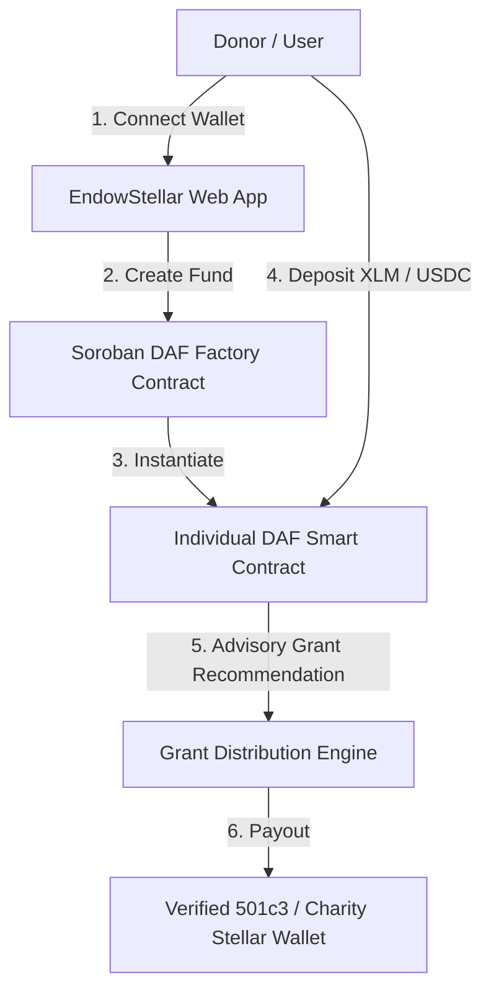

# EndowStellar 🌌✨

**EndowStellar** is a modern, transparent **Donor-Advised Fund (DAF) and Philanthropy Protocol** built on the **Stellar Blockchain** and **Soroban Smart Contracts**. 

Inspired by onchain donor-advised fund platforms like Endaoment, EndowStellar enables donors to establish tax-deductible charitable funds, deposit Stellar assets (XLM, USDC, asset tokens), hold & grow funds onchain, and recommend grant disbursements to 501(c)(3) nonprofits and global impact initiatives with sub-second finality and near-zero network fees.

---

## 🌟 Product Offering & Core Features

* **Onchain Donor-Advised Funds (DAFs):** Instant creation of personal or organizational DAF smart contracts on Soroban without account minimums or subscription fees.
* **Low-Cost, Fast Giving:** Leverage Stellar's ultra-low fees and 3-5 second finality for micro-donations and large-scale endowment distributions alike.
* **Multi-Asset Support:** Accept XLM, Stellar USDC, and custom Soroban/SEP-41 tokens with instant receipt generation.
* **Grant Disbursement Protocol:** Recommend grants directly to verified nonprofit Stellar addresses or traditional fiat payouts via Stellar Anchors.
* **DAF Migration:** Seamlessly transition capital from legacy DAF providers (Fidelity Charitable, Schwab Charitable) into low-cost onchain Stellar endowments.
* **Collaborative Advisory:** Multi-signature & role-based donor advisory management for family funds and corporate giving programs.

---

## 🏗 System Architecture



### Repository Structure

```text
endowStellar/
├── apps/
│   └── web/                   # Next.js / React web dashboard & DAF management portal
├── contracts/                 # Soroban Rust smart contracts
│   ├── daf_factory/           # Factory contract for instantiating new DAFs
│   └── daf_fund/              # Core DAF contract (deposits, advisory rules, grants)
├── scripts/                   # Deployment and testing utility scripts
└── README.md                  # Project documentation
```

---

## 🚀 Quick Start Guide

### Prerequisites

* **Node.js**: `v18.x` or higher
* **Rust & Cargo**: `v1.75+` with `wasm32-unknown-unknown` target
* **Stellar CLI**: Installed for Soroban contract compilation & deployment

### 1. Clone & Install Workspace Dependencies

```bash
git clone https://github.com/your-org/endowStellar.git
cd endowStellar
npm install
```

### 2. Set Up Environment Variables

Copy `.env.example` to `.env.local` inside `apps/web/`:

```bash
cp .env.example apps/web/.env.local
```

### 3. Build Soroban Smart Contracts

```bash
npm run contract:build
```

To run Rust unit tests for Soroban contracts:

```bash
npm run contract:test
```

### 4. Run Frontend App Locally

```bash
npm run dev
```

Open [http://localhost:3000](http://localhost:3000) in your browser.

---

## 📜 Soroban Smart Contracts Overview

### `daf_factory`
* **`create_fund(donor: Address, fund_name: String) -> Address`**: Deploys a new isolated DAF smart contract for the donor and registers it in the global directory.
* **`get_funds_by_donor(donor: Address) -> Vec<Address>`**: Fetches all DAF contract addresses managed by a specific donor.

### `daf_fund`
* **`deposit(from: Address, token: Address, amount: i128)`**: Deposits supported Stellar assets into the DAF.
* **`recommend_grant(to: Address, amount: i128, memo: String)`**: Recommends a grant distribution to a charity.
* **`get_balance(token: Address) -> i128`**: Returns the current asset balance held in the fund.

---

## 🛡 Security & Compliance

* **Tax Exemption Infrastructure:** Integrates with verified 501(c)(3) lookup databases and generates standardized tax donation receipts.
* **Non-Custodial Design:** Donors maintain explicit advisory control via smart contract permissions.

---

## 📄 License

Distributed under the MIT License. See `LICENSE` for more information.
